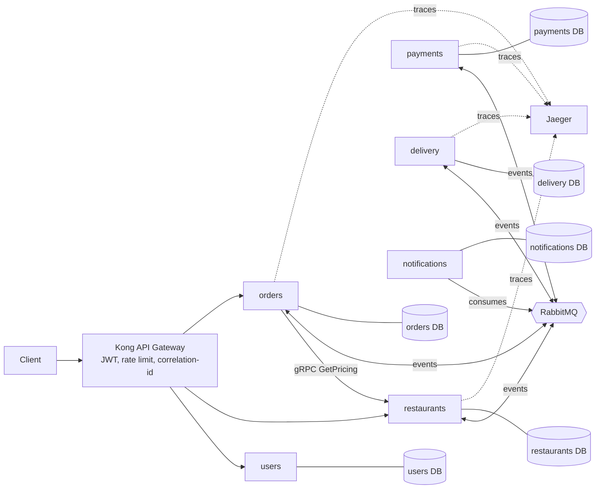

# Microservices-Based Food Delivery Backend

A food delivery backend split into small, independently deployable services (users, restaurants, orders, payments, delivery, notifications) that cooperate through events. Order placement is coordinated with the **saga pattern**: if payment fails, the order is cancelled and reserved stock is released.

| | |
|---|---|
| Track | Backend Development |
| Batch start | 30 October 2026 |
| Deadline | 30 November 2026 |
| Estimated effort | 14 days |

## Tech stack

| Concern | Technology |
|---|---|
| Services | NestJS (TypeScript) |
| Database | MongoDB (one database per service) |
| Async messaging | RabbitMQ (topic exchange, events such as `OrderPlaced`, `PaymentCompleted`) |
| Sync service-to-service | gRPC (pricing and availability check) |
| API gateway | Kong (routing, JWT auth, rate limiting) |
| Tracing | OpenTelemetry + Jaeger |
| Orchestration | Docker Compose (K8s manifests optional) |
| Load testing | k6 |
| Testing / CI | Jest, Supertest, GitHub Actions |

## Architecture at a glance



No service reads another service's database. Data crosses boundaries only through events or gRPC.

## Documentation

| Doc | Contents |
|---|---|
| [01 Architecture](docs/01-architecture.md) | Service boundaries, data ownership, repo layout |
| [02 Saga](docs/02-saga.md) | Happy path, compensation, choreography vs orchestration |
| [03 Event catalog](docs/03-event-catalog.md) | Every event, producer, consumers, payload |
| [04 Infrastructure](docs/04-infrastructure.md) | Docker Compose, Kong, RabbitMQ, gRPC, Jaeger tracing |
| [05 Reliability and extras](docs/05-reliability-and-extras.md) | Outbox, idempotency, atomic stock, DLQ, failure injection |
| [06 Schedule](docs/06-schedule.md) | 14-day plan |
| [07 Demo script](docs/07-demo-script.md) | What to show in the recording and presentation |
| [08 Testing and results](docs/08-testing-and-results.md) | Test plan and a template for real numbers |
| [09 Presentation and reflection](docs/09-presentation-and-reflection.md) | 10-minute outline and reflection template |

## Quick start

> Fill this in as you build. Target experience: one command brings everything up.

```bash
git clone <your-repo-url>
cd food-delivery
cp .env.example .env
docker compose up --build
```

| URL | What |
|---|---|
| http://localhost:8000 | Kong gateway (all client traffic goes here) |
| http://localhost:16686 | Jaeger UI |
| http://localhost:15672 | RabbitMQ management UI |

## Deliverables checklist

- [ ] Working demo (deployed or screen-recorded)
- [ ] GitHub repository with clean commits, README, setup instructions
- [ ] Architecture diagram and data / API documentation
- [ ] Test results and performance numbers
- [ ] 10-minute final presentation (problem, design, challenges, results, next steps)
- [ ] Individual reflection from each intern

## Repository layout

```
food-delivery/
├── services/{users,restaurants,orders,payments,delivery,notifications}/
├── libs/              # shared: event contracts, proto types, OpenTelemetry setup
├── proto/pricing.proto
├── gateway/kong.yml
├── docker-compose.yml
├── load-tests/        # k6 scripts
├── docs/              # architecture, event catalog, results
└── README.md
```

## Reference data (optional)

Zomato and Swiggy Restaurants (Kaggle) for restaurant seed data, Open Food Facts for menu items, Food Delivery Time datasets (Kaggle) for realistic delivery estimates, Yelp Open Dataset.
