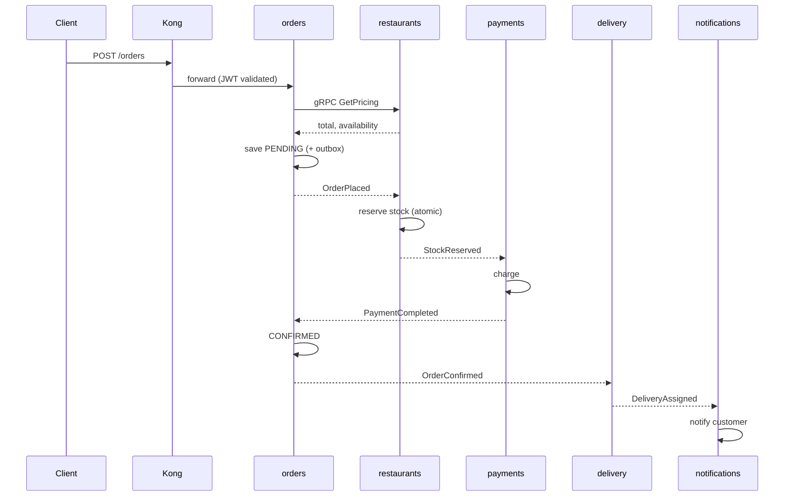
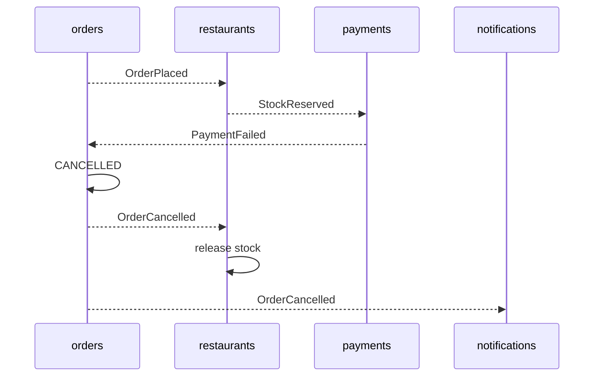

# 02 Saga: placing an order

## Happy path

```
Client -> Kong -> orders: POST /orders
orders --gRPC GetPricing--> restaurants   (validates items, returns total)
orders: save PENDING, publish OrderPlaced
restaurants: reserve stock -> StockReserved | StockRejected
payments: charge -> PaymentCompleted | PaymentFailed
orders: PaymentCompleted -> CONFIRMED, publish OrderConfirmed
delivery: assign driver -> DeliveryAssigned
notifications: listens to everything, "sends" email/SMS (logged)
```



## Compensation (failure path)

`PaymentFailed` or `StockRejected` makes orders mark the order `CANCELLED` and publish `OrderCancelled`. Then:

- **restaurants** releases the reserved stock
- **notifications** tells the customer



## Order state machine

```
PENDING -> STOCK_RESERVED -> CONFIRMED -> OUT_FOR_DELIVERY -> DELIVERED
   |             |
   +-------------+--> CANCELLED
```

## Choreography vs orchestration

| | Choreography | Orchestration |
|---|---|---|
| How | Services react to each other's events | One coordinator drives steps with an explicit state machine |
| Pros | Simple, loosely coupled | Easy to reason about, demo, and debug |
| Cons | Flow is implicit and harder to follow | Coordinator knows more about other services |

**Decision:** orchestration inside the orders service. Record the trade-off in your presentation.
